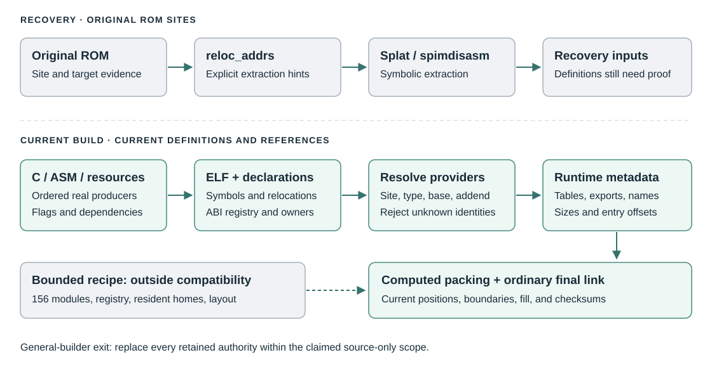
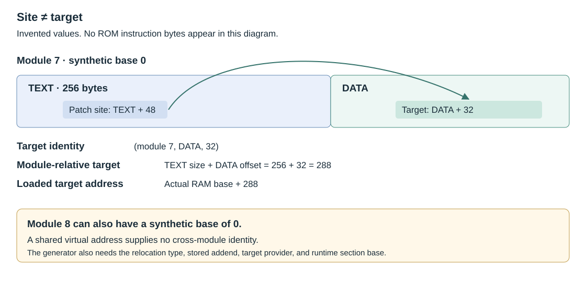
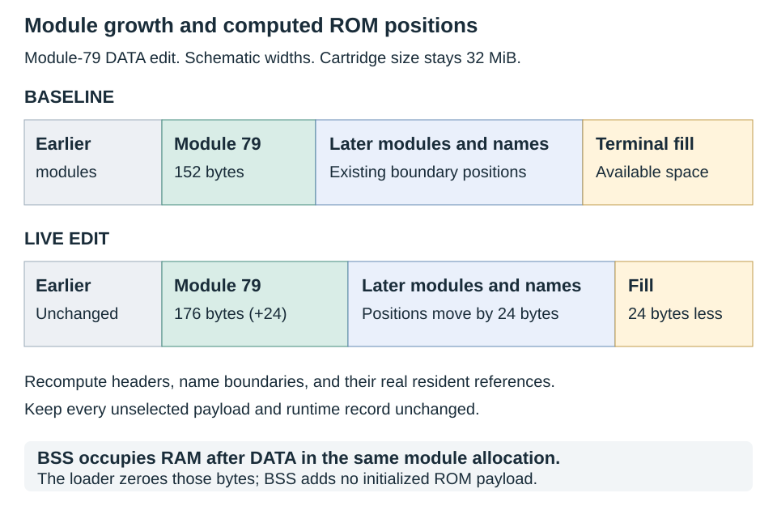

# JFG overlay handover

Gentarkin's goal for Jet Force Gemini (JFG) is a build that derives overlay tables from its current inputs.
Adding or removing an overlay should update its references, tables, and ROM positions through one declared build graph.
The original read-only memory (ROM) image remains a comparison target during recovery.
The finished generator must obtain its layout and identities from the current build.

Mickey's Speedway USA (MSU) supplies the reference tools described here.
This document explains their use, the remaining gaps, and the next tests.
It covers the United States (US) version of JFG.
It includes the prerequisites for the demonstrated module recipe.
It can be read without the earlier conversation.

## 1. Scope, source pins, and evidence

The audit checked source files and remote refs on **2026-10-27**.
JFG's current `master` still points to the snapshot used for the earlier build investigation.
A later source change requires a new check.

| Source | Exact revision | Use |
|---|---|---|
| [JFG master](https://github.com/Ryan-Myers/Jet-Force-Gemini/tree/efd5abb1c79636e297b831f7c2d5bf47eac39c0c) | `efd5abb1c79636e297b831f7c2d5bf47eac39c0c` | Current source audit; historical matching build |
| [JFG OverlayHandling](https://github.com/Ryan-Myers/Jet-Force-Gemini/tree/948e1f5acaa02d2df359ce647ca1f439036975d1) | `948e1f5acaa02d2df359ce647ca1f439036975d1` | Separate research branch; some format claims conflict with measured records |
| [MSU reference implementation](https://github.com/akratch/Mickeys-Speedway-USA-Decomp/tree/969b44238e048a01cff9832af8b41bda954d7bbf) | `969b44238e048a01cff9832af8b41bda954d7bbf` | All MSU source references in this handover |
| [Earlier public recipe](https://github.com/akratch/Mickeys-Speedway-USA-Decomp/tree/458df7cabc8efdaf766273fdfe54db885165e1e8) | `458df7cabc8efdaf766273fdfe54db885165e1e8` | Earlier runnable recipe; use a fresh receipt with the current kit |

The evidence has four levels:

- **Source audit:** inspected public files and current remote refs on 2026-10-27.
- **Build proof:** extracted and rebuilt JFG at the stated pin on 2026-10-23.
- **Recipe replay:** ran the current MSU kit against saved JFG inputs from the proved build on 2026-10-27.
- **Proposed work:** a required capability with no accepted general implementation yet.

The recipe replay reproduced the original ROM and the documented edited ROM.
It reused the saved edited producer and outside build inputs.
The baseline wrapper in section 6 was also assembled and linked again during this replay.
It was not a new extraction or a fresh installation.
The [JFG evidence report](runlink-jfg.md) gives the earlier measurements and proof limits.

This handover was prepared with AI assistance in MSU.
[JFG's README](https://github.com/Ryan-Myers/Jet-Force-Gemini/blob/efd5abb1c79636e297b831f7c2d5bf47eac39c0c/README.md) says that JFG does not currently accept AI-sourced contributions.
No JFG submission accompanies this document.
The maintainer decides whether to use its methods or evidence.

## 2. The three kinds of relocation information

An overlay is a module that the game can load into random-access memory (RAM) when needed.
Its final RAM address can change between loads.
A relocation identifies a stored address or instruction operand that needs adjustment.
The loader uses that information after it selects the RAM address.

The compiler stores its object output in Executable and Linkable Format (ELF).
The application binary interface (ABI) defines calls, data, and exported identities.



| Information | Reader | Purpose | Authority after a source edit |
|---|---|---|---|
| `reloc_addrs` | Splat and spimdisasm | Correct symbolic references during extraction | Recovery hints for the original ROM sites |
| ELF relocations | Linker and metadata generator | Describe references from current assembled or compiled inputs | Current symbolic references, with authenticated definitions and addends |
| Runtime relocation tables | JFG's loader | Patch loaded instructions and stored pointers | Generated records for the current module |

An **object file** is a compiler or assembler output in ELF format.
It contains sections, symbols, and relocations.
A C **object** is a storage allocation, such as a variable or array.
These meanings need separate terms in a build design.

A **site** is the location to patch.
A **target** is the function or datum that the reference must reach.
A symbol name identifies a target only when its owner and definition are known.
An undefined symbol does not supply a storage allocation.



Several overlays can have a synthetic ELF address of zero.
Use `(module, section, offset)` to identify their definitions.
A shared address or an offset-zero placeholder name cannot identify a function across overlays.

### What Gentarkin's six rows do

The proposed rows give Splat specific names and relocation types at six original ROM sites:

```text
rom:0x1ED3B2C symbol:texLoadSprite reloc:MIPS_26
rom:0x1ED3B34 symbol:D_O1_0020_DATA reloc:MIPS_HI16
rom:0x1ED3B38 symbol:D_O1_0020_DATA reloc:MIPS_LO16
rom:0x1ED3B40 symbol:texLoadSprite reloc:MIPS_26
rom:0x1ED3B48 symbol:D_O1_0024_DATA reloc:MIPS_HI16
rom:0x1ED3B4C symbol:D_O1_0024_DATA reloc:MIPS_LO16
```

`MIPS_26` describes a jump or call operand.
`MIPS_HI16` and `MIPS_LO16` describe parts of an address calculation.
Their pairing and stored addends require the actual instruction and relocation sequence.

The earlier Splat pilot applied these six rows to module 1.
See [the extraction evidence](runlink-jfg.md#6-actual-reloc_addrs-extraction-pilot-verified) for the control and result.
Its initializer remained 288 bytes with 13 relocation sites.
Only the six requested symbolic identities changed.
The three named targets remained undefined in that object.

Thus, the experiment proved that the hints reach the generated symbolic assembly.
It did not supply definitions, allocation sizes, section boundaries, or a complete module generator.
It also did not prove the full ROM after that extraction change.

### Procedure A: repeat the extraction pilot

1. Make a private copy of the pinned JFG checkout.
2. Save the ordinary extraction and assembled initializer as the control.
3. Create a private relocation file with the six rows above.
4. Add its path under `options` in `ver/splat/jfg.us.yaml`:

```yaml
options:
  reloc_addrs_path: ver/relocs/jfg.us.reloc_addrs.txt
```

5. Retain all other existing options in that mapping.
6. Run the same extraction command in the private copy.
7. Assemble the complete initializer with the same prelude and assembler flags.
8. Compare section sizes, relocation sites, relocation types, symbol identities, and order.
9. Check each target against its real provider before accepting its name.
10. Before you claim a matching extraction change, rebuild the full ROM.

The path resolves against Splat's configured base path.
The pinned JFG configuration sets that base to the repository root.
The installed Splat parser also accepts an optional `addend` field.
Its default is zero; that default supplies no proof of the intended target.
[Splat's parser](https://github.com/ethteck/splat/blob/1d09139b886f0bece632bd8f367ccc1d3318ca2a/src/splat/util/relocs.py) defines the accepted syntax.

Neither audited JFG branch supplies `reloc_addrs` through its tracked US configuration.
Once source changes move a site, use the current ELF relocation.
Do not carry the original ROM address into the edited layout.

## 3. JFG's current build and loader

Start with these pinned JFG files:

| File | What to inspect |
|---|---|
| [src/runLink.c](https://github.com/Ryan-Myers/Jet-Force-Gemini/blob/efd5abb1c79636e297b831f7c2d5bf47eac39c0c/src/runLink.c) | `ResolveRelocAddress`, `ProcessRelocationEntry`, allocation, loading, unloading, and resident patching |
| [src/runLink.h](https://github.com/Ryan-Myers/Jet-Force-Gemini/blob/efd5abb1c79636e297b831f7c2d5bf47eac39c0c/src/runLink.h) | Actual header fields, selector widths, and record structures |
| [ver/splat/jfg.us.yaml](https://github.com/Ryan-Myers/Jet-Force-Gemini/blob/efd5abb1c79636e297b831f7c2d5bf47eac39c0c/ver/splat/jfg.us.yaml) | Original extraction boundaries; binary inputs for the existing tables |
| [Makefile](https://github.com/Ryan-Myers/Jet-Force-Gemini/blob/efd5abb1c79636e297b831f7c2d5bf47eac39c0c/Makefile) | Original compiler flags, object targets, `PATCH_SYMBOLS`, extraction, and final link |
| [ver/symbols/overlay_funcs_to_trap.txt](https://github.com/Ryan-Myers/Jet-Force-Gemini/blob/efd5abb1c79636e297b831f7c2d5bf47eac39c0c/ver/symbols/overlay_funcs_to_trap.txt) | Resident call identities that normal object processing replaces with a trap |
| [OverlayHandling format notes](https://github.com/Ryan-Myers/Jet-Force-Gemini/blob/948e1f5acaa02d2df359ce647ca1f439036975d1/docs/overlays.txt) | Research context; verify the conflicting claims listed below |

The current ordinary build includes extracted binary tables.
A successful retail rebuild therefore proves reproduction of those inputs.
It does not prove regeneration of their identities or layout.

The module header stores TEXT size, DATA size, BSS size, two table sizes, and two entry offsets.
JFG names the BSS field `RodataSize` at offset `0x10`.
The allocation and zeroing code uses this field for BSS.
It cannot supply the missing readonly boundary inside an extracted DATA section.

Both relocation table sizes are byte sizes in unsigned 16-bit fields.
Each record occupies eight bytes.
Check the actual loader and field limits before accepting generated sizes.
MSU's stricter primary-table policy cannot be copied into JFG without review.

### Tables, records, and section bases

| Structure | Encoding or role |
|---|---|
| Module header | 32 bytes; sizes, ROM position, runtime address, and two entry offsets |
| Export row | Four bytes; a 12-bit selector and a 20-bit offset |
| Runtime record | Eight bytes; a symbol/base field followed by packed site, MIPS type, and operation |
| Primary table | External SYMBOL records; retained after initial loading |
| Secondary table | Local and self-reference records; discarded after initial loading |
| Name offsets and name bytes | Debug lookup by export row; separate from export addresses |

A module's ROM payload contains TEXT, DATA, the primary table, and the secondary table, in that order.
Its BSS allocation adds no initialized bytes to that payload.
A relocation site is measured from the module's TEXT base, including sites inside DATA.
The header's ROM position is relative to the configured module-image base.
The loader updates the header's runtime address after allocation.

The packed record's second word is `site << 8 | type << 4 | operation`.
The operation is SYMBOL 0, LOCAL 1, JUMP 2, or DATA 3.
The first word's meaning depends on that operation.

| Operation | First-word meaning |
|---|---|
| SYMBOL | Export row index |
| LOCAL | Runtime section base expressed as a module-relative offset |
| JUMP | Retained preceding SYMBOL index; the target comes from the local jump operand |
| DATA | Resident pointer-patching mode; not the general mode for a module DATA site |

A target's allocation and the base encoded in a LOCAL record are separate facts.
Some BSS targets use a DATA-relative stored operand.
Recover that operand from the actual producer and loader rule.

The original name table reuses one string offset for a repeated name.
The source registry needs a stated rule for that shared storage.
The [format evidence](runlink-jfg.md#1-format-verified) gives the original boundaries and byte-round-trip result.

### Retail US configuration landmarks

These addresses identify recovery inputs in the pinned original image.
An edited packer must derive its new boundaries from the current outputs.

| Structure | Original ROM address |
|---|---|
| Resident relocation block | `0x1ECF220` |
| Export rows | `0x1ED0270` |
| 157 module headers | `0x1ED2780` |
| Module-image base | `0x1ED3B20` |
| Module-image end | `0x1FEB038` |
| Name offsets | `0x1FEB040` |
| Name bytes | `0x1FED550` through `0x1FF6820`, end excluded |

The [JFG configuration](../tools/runlink/configs/jfg-us.toml) also records resident bases and reserved selectors.

### Existing helpers: useful scope and specific defects

The command-line interface (CLI) exposes the operations implemented in each helper's parser.

| JFG helper | Current behavior | Consequence |
|---|---|---|
| [overlay_reloc.py](https://github.com/Ryan-Myers/Jet-Force-Gemini/blob/efd5abb1c79636e297b831f7c2d5bf47eac39c0c/tools/overlay_reloc.py) | CLI implements `analyze` and `patch-names` | Its advertised `generate` command is not implemented |
| [overlay_linker.py](https://github.com/Ryan-Myers/Jet-Force-Gemini/blob/efd5abb1c79636e297b831f7c2d5bf47eac39c0c/tools/overlay_linker.py) | Draft scripts use `0x80200000`; exports and imports come from the ROM | Useful recovery aid; further work must establish current build authority |
| [overlay_build.py](https://github.com/Ryan-Myers/Jet-Force-Gemini/blob/efd5abb1c79636e297b831f7c2d5bf47eac39c0c/tools/overlay_build.py) | Extracts and reinjects fixed regions | Cannot derive a changed cartridge layout |
| `extract_individual_overlays` in that file | Multiplies the primary byte size by eight; omits the secondary size | Do not use its calculated image extent as a packer rule |

These helper findings come from source inspection.
They are not new execution results for those helpers.

### Format rules that need correction

The [measured format report](runlink-jfg.md#2-the-rules-tested-on-the-rom-alone-verified) supplies the record evidence.
Its results conflict with several claims in the research branch:

- Module data-site references can use SYMBOL or LOCAL records.
- DATA records occur in the resident table's three pointer entries.
- A JUMP record can retain the preceding SYMBOL row index.
- LOCAL HI16 and LO16 records are common and require support.
- Sorting all records by site does not reproduce their original order.
- Self-references through SYMBOL records affect the primary/secondary split.

Of 287 nonempty module tables, 113 are not sorted by site.
Keep compiler input order before an aggregate linker changes that order.
Resident records have their own ordering rule.

A separate native-port issue exists in `GetSymbolName`.
Its current C returns a pointer into a local 96-byte array.
Review that lifetime contract before using this API in a native port.
A host metadata generator should own its name storage directly.

## 4. Measured recovery gaps

These figures describe the full build investigated on 2026-10-23 at the same JFG source pin.
They are relocation diagnostics, not percentages of decompiled code.

| Measurement | Result | Meaning |
|---|---:|---|
| Modules | 157; 155 nonempty | Modules 21 and 56 are empty |
| Module runtime records | 27,515 | 11,076 primary; 16,439 secondary |
| Runtime sites covered by object relocations | 21,302 / 27,515 | 77.4% site coverage; identity still needs proof |
| Missing object relocation sites | 6,213 | 2,275 HI16; 2,280 LO16; 1,658 DATA |
| Extra object relocations | 3,832 | 3,819 DATA; 13 TEXT HI16/LO16 |
| Covered sites with wrong target identity | 19,104 | An ELF relocation can exist and still name the wrong function |
| Covered sites with correct target identity | 2,198 | Site coverage alone overstates usable identity coverage |
| Modules with a hidden readonly base | 80 | The flat extracted DATA section loses this runtime distinction |
| Modules with unrepresented BSS ownership | 62 | Existing inputs do not establish their allocations |
| Resident runtime records | 520 | 513 trap calls; four HI16/LO16 records; three DATA records |

An unpatched build of 21 resident C objects recovered names for the 513 trap calls.
Of those names, 474 agreed with the shipped identities; 39 did not.
Identical trap instruction bytes cannot distinguish those wrong callees.
The handwritten refract-output input was outside that unpatched C rebuild.

The object-only comparison had 32,334 residuals after unpatched inputs were supplied.
The identity-assisted comparison had 11,295 residuals.
These totals combine different failure classes.
They cannot serve as counts of missing records or a project completion percentage.

The export table has 2,372 rows and 2,371 distinct names.
Four rows lacked normal definitions in that build:

| Name | Existing selector or owner | Required investigation |
|---|---|---|
| `Skips` | Module 2 | Establish the actual provider |
| `pausePlayer` | Module 19 | Establish the actual provider |
| `pausetunevol` | Module 12 | Establish the actual provider |
| `__osRdbSend` | Anomalous selector `0xD66` | Explain or reject the reserved identity |

The `osTvType` row suggests an absolute base of `0x80000000` for selector `0xFFC`.
That interpretation is an inference; the audited loader has no corresponding case.
Do not generalize it into unrestricted absolute-address support.

## 5. Run the public recovery kit

The portable kit requires Python 3.11 or later.
Its own code uses the Python standard library.
The JFG build separately needs its compiler, assembler, submodules, Python dependencies, and ROM.

The proved build used IDO 5.3 and asm-processor `f3b2f85a5bc7e8ae2030ea5a83ea8aa0bcbede03`.
It used Splat 0.50.0, spimdisasm 1.42.3, Python 3.14.7, and GNU Binutils `2.46.0.20260210`.
These versions record the successful environment.
A complete fresh-install dependency lock was not produced.

Keep ROMs, generated assembly, assets, ELF files, maps, and detailed receipts private.
The kit does not distribute them.

### Procedure B: establish a current baseline

1. Clone the public MSU repository for the kit.
2. Check out the MSU pin in section 1.
3. Clone JFG into a separate private working directory.
4. Check out the JFG master pin in section 1.
5. Initialize JFG's submodules at that pin.
6. Install JFG's documented build dependencies.
7. Supply your own JFG US ROM.
8. Check its SHA1 against `493ced9008dbe932d6e91179b68e8630cf23a023`.
9. Set the path variables below for your own installation.

```sh
# Run from the pinned MSU checkout. Replace the other example paths.
KIT="$(pwd)"
JFG=/path/to/private/JFG
PILOT=/path/to/private/jfg-pilot
CROSS=/path/to/binutils/mips64-elf-
```

10. Run JFG's extraction command from its checkout:

```sh
gmake extract CROSS="$CROSS"
```

11. Run JFG's ordinary build from the same checkout:

```sh
gmake CROSS="$CROSS"
```

12. Check the SHA1 of `build/jfg.us.z64` independently.
13. Keep the full command logs and current object graph.

Use GNU make; its installed command can be `make` or `gmake`.
A matching ROM left by an older build does not authenticate the current objects.
During this handover replay, one local reference copy failed the unselected-module check at module 80.
The saved matching build passed the same current recipe.
Use the recipe's refusal as a reason to re-establish the outside build inputs.
Do not suppress that refusal.

### Procedure C: measure the baseline

1. Run these commands from the kit checkout:

```sh
python3 tools/runlink --config jfg-us --root "$JFG" check
python3 tools/runlink --config jfg-us --root "$JFG" census -v
python3 tools/runlink --config jfg-us --root "$JFG" generate --mode objects
python3 tools/runlink --config jfg-us --root "$JFG" generate --mode oracle
```

2. Save each command's exit status and complete output.
3. Classify missing sites, incorrect identities, lost section bases, and changed order separately.

`check` tests encoding round trips.
`census` checks format rules against existing records.
`objects` obtains identities from build inputs.
`oracle` borrows shipped identities to isolate other failures.
The default generation mode is `hybrid`; specify `objects` for an object-only measurement.
`check-build` and `parity` currently support MSU only.

For resident identity recovery, rebuild the affected C targets with `BUILD_DIR=build_unpatched PATCH_SYMBOLS=:`.
For example, the target spelling is `build_unpatched/src/NAME.c.o`.
The affected target inventory requires a separate audit of resident calls and the trap-renaming list.
A full unpatched build was not proved by the earlier 21-object experiment.

After that rebuild, measure with the alternate input prefix:

```sh
python3 tools/runlink --config jfg-us --root "$JFG" generate --mode objects \
  --unpatched build/=build_unpatched/ -v --limit 100000
```

## 6. Reproduce the complete module-79 example

The public `module-recipe` command generates tables from a corrected symbolic ELF producer.
Its admitted format covers the demonstrated module and reference shapes.
It does not automatically reconstruct C or correct extraction identities.

The selected module is `src/overlays/o79/overlay_79.c`.
Its current source includes two assembly functions through `GLOBAL_ASM`.
This experiment therefore uses symbolic assembly producers.
It establishes a metadata and final-link path; C reconstruction remains separate work.

| Binding | Existing row | Actual definition |
|---|---:|---|
| `buoyInit` export | 1359 | Module 79 TEXT offset 0; size 108 |
| `buoyControl` export | 1472 | Module 79 TEXT offset 108; size 36 |
| `hitInitObjectHit` import | 168 | Sized resident function in `.main` |

### Procedure D: prepare the baseline producer

1. Create a private baseline directory under `$PILOT`.
2. Copy the complete generated `buoyInit.s` and `buoyControl.s` into that directory.
3. Use the files under `asm/nonmatchings/overlays/o79/overlay_79/`.
4. Remove extraction comments and `nonmatching` annotation lines from these private copies.
5. Authenticate row 168 against the real resident definition of `hitInitObjectHit`.
6. Correct the initializer's single call operand to that symbol.
7. Keep the initializer's own `buoyInit` definition.
8. Keep every other instruction and the original function order.
9. Create this metadata wrapper as `$PILOT/baseline/module.s`:

```asm
.text
.include "buoyInit.s"
.type buoyInit,@function
.size buoyInit, .-buoyInit
.include "buoyControl.s"
.type buoyControl,@function
.size buoyControl, .-buoyControl
```

The uncorrected extraction names that call `buoyInit`, because the callee also has an offset-zero identity.
A global text replacement would corrupt the caller's own label.
JFG sets `asm_emit_size_directive: False`; the recipe requires genuine, complete function extents.
The wrapper supplies those extents from the complete assembled functions.
It contains no copied instruction listing.

10. Save this ordinary partial-link script as `$PILOT/module.ld`:

```ld
SECTIONS {
  .text 0 : { *(.text) . = ALIGN(8); }
  .data 0 : { *(.data) . = ALIGN(8); }
  .bss 0 (NOLOAD) : { *(.bss) . = ALIGN(8); }
}
```

11. Assemble from the JFG checkout:

```sh
"${CROSS}as" -march=vr4300 -32 -G0 -I include -I "$PILOT/baseline" \
  tools/asm-processor/prelude.inc "$PILOT/baseline/module.s" \
  -o "$PILOT/baseline/producer.o"
```

12. Produce the relocatable module with the ordinary linker:

```sh
"${CROSS}ld" -EB -m elf32ebmip -r -T "$PILOT/module.ld" \
  -o "$PILOT/baseline/module.elf" "$PILOT/baseline/producer.o"
```

13. Check for 144 TEXT bytes, no DATA bytes, and one undefined resident call.
14. Check the two function extents against the binding table above.
15. Create `$PILOT/bindings.json` with this content:

```json
{
  "schema": "jfg-current-module-example-v1",
  "module": 79,
  "imports": { "hitInitObjectHit": 168 },
  "exports": { "buoyInit": 1359, "buoyControl": 1472 }
}
```

These rows are explicit existing ABI identities.
The recipe checks their names against the compatibility registry.
It requires all selected exports; it cannot assign arbitrary new rows.

### Procedure E: generate and link

1. Select a fresh output directory outside every path component named `build`.
2. Use paths without whitespace, double quotes, or backslashes.
3. Run the baseline recipe from the kit checkout:

```sh
python3 tools/runlink --config jfg-us --root "$JFG" module-recipe \
  --elf "$PILOT/baseline/module.elf" --declarations "$PILOT/bindings.json" \
  --out "$PILOT/recipe-baseline" --link --expect-retail --cross "$CROSS"
```

The `build` path restriction follows from the recipe's current linker-input scan.
A replay under such a path failed by treating the generated wrapper as an outside input.
The workaround changes only the output location.

`--expect-retail` requires `--link`.
Without `--link`, the command only generates metadata inputs.
The final-link path requires the exact JFG pin and its real outside build inputs.

### Procedure F: test a live DATA edit

1. Keep the accepted baseline producer and its outputs.
2. Make a separate changed producer directory.
3. Add a real four-byte float definition with value `12.0`.
4. Give that datum an ELF OBJECT type and a four-byte size.
5. Replace the controller's live `8.0` constant construction with a symbolic load of that datum.
6. Keep the complete functions and their order.
7. Assemble and partially link the changed producer through Procedure D.
8. Check for one LOCAL HI16/LO16 pair to the real datum.
9. Run the edited recipe:

```sh
python3 tools/runlink --config jfg-us --root "$JFG" module-recipe \
  --elf "$PILOT/changed/module.elf" --declarations "$PILOT/bindings.json" \
  --out "$PILOT/recipe-changed" --link --cross "$CROSS"
```

The changed producer is a manual prerequisite.
This handover does not distribute its extracted function bodies.
A different valid edit needs its own expected values and proof.

| Demonstrated property | Baseline | Documented live edit |
|---|---:|---:|
| TEXT bytes | 144 | 144 |
| Semantic DATA bytes | 0 | 4 |
| Physical DATA bytes | 0 | 8, including ordinary alignment |
| Primary table bytes | 8 | 8 |
| Secondary table bytes | 0 | 16 |
| Packed module bytes | 152 | 176 |
| Unselected modules unchanged | 156 | 156 |
| Final ROM SHA1 | `493ced9008dbe932d6e91179b68e8630cf23a023` | `ca357d4e64635c025dcefdf546ec1f9d8777b9c2` |

The live edit grows the packed module by 24 bytes.
Later module positions and name boundaries move by 24 bytes.
Four real resident LO16 references follow the moved name boundaries.
The demonstrated movement does not cover a 64 KiB boundary carry.
The terminal fill contracts by 24 bytes; the cartridge remains 32 MiB.
Only checksum-header processing changes bytes after objcopy.



### Receipts and failure checks

Keep the producers, declarations, original objects, module ELF files, logs, maps, generated inputs, and final images privately.
Also keep `receipt.json`, `link-receipt.json`, and their input hashes.
A new CLI implementation hash requires a new receipt.

Require these results before accepting the example:

- The baseline final ROM equals the original ROM in full.
- Selected section bytes equal the current producer's section bytes.
- Every ordered relocation has the current site, type, addend, and target identity.
- Every selected export has a real sized definition at its current offset.
- All 156 unselected images and runtime records remain unchanged.
- Name payloads and resident runtime records remain unchanged.
- Each resident instruction change follows a real linker boundary relocation.
- Final headers, table sizes, fill, and cartridge extent pass independent decoding.

The recipe removes the selected old module and export rows from its compatibility decode.
It still borrows unselected modules, registry names, resident homes, and outside layout authority.
Its receipt therefore states `source_only: false` and `general_adapter: false`.

## 7. Supported inputs and current refusals

The JFG recipe accepts a big-endian MIPS relocatable ELF file.
TEXT and DATA must have zero-based addresses and the expected alignment and flags.
Sized functions must cover all TEXT bytes.
Its admitted references are resident JAL calls and the demonstrated local DATA pair.

| Input or operation | Current JFG recipe |
|---|---|
| Existing selected exports and resident imports | Supported through explicit existing row declarations |
| One genuine four-byte datum at DATA offset zero | Supported with four bytes of ordinary alignment |
| Nonempty BSS or separate readonly section | Refused |
| Data-site relocations, internal calls, or nonzero addends | Refused |
| Init/resume entries or arbitrary additional allocations | No admitted interface |
| New module, new export, or removal | No admitted interface |
| General source-driven name table | Not implemented by this recipe |
| Bootstrapping all identities without the ROM | Not established |

A section clause in the example linker script does not extend this admitted input format.
Unsupported cases need new provider contracts and positive and negative tests.

## 8. Where to look in MSU

The portable format code is the first reuse target.
MSU's larger frontend supplies implementation examples for authenticated current inputs.
Its project-specific declarations and proof rules need adaptation to JFG.

| MSU file or function | Reuse or study | Limit |
|---|---|---|
| [configs/jfg-us.toml](../tools/runlink/configs/jfg-us.toml) | JFG boundaries, selectors, names, sections, and build paths | Describes the pinned retail image |
| [codec.py](../tools/runlink/codec.py), `decode`, `layout_modules`, `encode_modules` | Encode headers and records; compute module ROM positions | Caller must supply justified current sizes and identities |
| [rules.py](../tools/runlink/rules.py), `build_module` | Convert ordered symbolic references into runtime records | Exact pairing, bases, addends, and order remain caller obligations |
| [elf.py](../tools/runlink/elf.py), `in_place_addends` | Read real MIPS ELF symbols and relocations | ELF presence alone does not authenticate a guessed target name |
| [names.py](../tools/runlink/names.py), `encode_names` | Encode a declared export-name registry | JFG needs its own authored registry authority |
| [jfg_module_recipe.py](../tools/runlink/jfg_module_recipe.py), `generate`, `link_rom` | Complete bounded JFG producer-to-ROM example | Explicit outside compatibility inputs remain |
| [runlink_metadata_link.py](../tools/runlink_metadata_link.py), `edited_input_declarations`, `edited_compile_group` | Ordered source inputs and ordinary aggregate linking | MSU-specific frontend and admitted provider classes |
| Same file, `edited_original_provider_inventory`, `edited_alias_projection` | Remove compatibility assignments that shadow authentic selected definitions | Keep real final allocations and map checks |
| [proof_provenance.py](../tools/proof_provenance.py) | Capture current source, compiler recipes, debug records, and input hashes | A content hash alone does not establish semantic ownership |
| [link_overlay_module.py](../tools/link_overlay_module.py) | Section-relative module linking and genuine local providers | Do not copy an MSU-specific profile without its proof |
| [runlink_pack.py](../tools/runlink_pack.py) | MSU resolver, runtime records, export registry, and compatibility checks | Contains retail recovery paths; separate them from a source-only route |
| [Toolkit reference](runlink-toolkit.md) | Commands, schemas, ordered C inputs, and proof limits | Current implementation reference |
| [Native boundary contracts](native-boundaries.md) | ABI, bounds, resource, lifetime, and hardware review | Separate acceptance work beyond byte equality |

At the MSU pin, the final metadata route uses 198 generated inputs and zero retained metadata inputs.
Its bootstrap and identity recovery still depend on compatibility information.
That final-link count therefore does not establish a general source-only builder.

The MSU frontend can build an ordered vector of C inputs within its existing ABI registry.
Its accepted examples cover cross-input DATA use and a real private BSS provider.
The current proof also authenticates prepared static FUNCTION identities against original compiler debug information.
The reviewed overlay-66 graph retains 55 runtime records and its actual BSS allocation.

Typed resident `u16 *` cell evidence is available for its admitted consumers.
Static DATA/BSS recovery, COMMON allocations, and other unsupported provider classes remain outside that proof.
Unmerged experiments are excluded from this handover's supported interface.

MSU's source ownership campaign, code cleanup, and native-port contracts remain separate unfinished work.
JFG can use this kit before those campaigns finish.
They do not supply a completed general JFG builder.

## 9. Complete the general builder

The next implementation needs one declared graph of real build inputs.
That graph must include ordered C, assembly, and resource inputs, with their actual flags and dependencies.
It must identify each export's owner, kind, runtime section, and entry role.
A real opaque resource needs an explicit resource representation.
A copied payload disguised as an unexplained C array supplies no semantic reconstruction.

An authored ABI registry can assign stable module and export IDs.
Their original global sorting algorithm is unnecessary for a new editable build.
The baseline compatibility profile still needs the original IDs to reproduce the retail image.
Keep registry policy separate from values derived from current definitions.

| Stage | Implementation work | Acceptance result |
|---|---|---|
| 1. Declare inputs and ABI | Record ordered producers, flags, owners, imports, exports, entries, and resources | Missing, duplicate, and foreign providers are rejected |
| 2. Recover real references | Correct unresolved calls, DATA sites, addends, and original input order | Current symbols resolve through actual allocated providers |
| 3. Establish runtime roles | Derive TEXT, DATA, readonly bases, BSS, and init/resume entries | Real DATA/BSS growth changes records and allocation correctly |
| 4. Generate metadata | Emit both tables, export rows, names, offsets, and headers | No selected old table or target-site identity supplies a result |
| 5. Pack current outputs | Derive positions, alignment, boundary symbols, fill, and checksums | Code and data growth survives the ordinary final link |
| 6. Change the graph | Add or remove modules and exports through declarations | Every dependent reference and load ID updates or fails with a specific error |
| 7. Prove independence | Remove old selected images and metadata before a cold build | The build succeeds from declared current inputs alone |
| 8. Review native contracts | Audit ABI, indexing, lifetime, resource use, and hardware behavior | Native assumptions have explicit contracts and tests |

### Required edit and refusal tests

1. Prove the baseline through complete ROM equality.
2. Grow real code in one module.
3. Grow live initialized data in another module.
4. Grow real BSS without adding ROM payload bytes.
5. Move an export within its actual provider.
6. Edit two nonadjacent modules in one build.
7. Add an init or resume entry through a real function definition.
8. Move boundaries across a 64 KiB carry.
9. Add a module with real code and data consumers.
10. Remove a provider that has a code caller.
11. Remove a provider that has an initializer reference.
12. Require a specific unresolved-reference error for both removals.
13. Add and remove an unused export through the ABI registry.
14. Reject field overflow, duplicate ownership, and ambiguous HI16/LO16 pairing.
15. Delete selected old bytes and tables before setup.
16. Poison old fallback paths in a separate negative control.
17. Change an input during a warm build.
18. Require refusal of the stale result.
19. Correct the input and prove recovery after that refusal.
20. Run the complete cold build from the declared graph.

Module removal also affects game-side load IDs and unload behavior.
The current evidence does not prove arbitrary interior removal or empty tombstones safe.
The registry design must state its ID policy before implementing those operations.

The final acceptance report must identify all remaining compatibility inputs.
Any retained old identity, section extent, table, or placement limits the source-only claim to a smaller scope.
A runtime test plan is also required before claiming gameplay or native equivalence.
This static build investigation did not execute a ROM or game binary.

## 10. First work packet for the JFG maintainer

1. Reproduce Procedures B and C at the pinned source revisions.
2. Reproduce the complete module-79 baseline through Procedures D and E.
3. Keep its input hashes, logs, and receipts.
4. Reproduce the real DATA edit through Procedure F.
5. Before you expand the accepted format, record the first refusal.
6. Define the authored registry and producer graph for stage 1.
7. Select one real BSS or data-site reference as the next capability.
8. Implement its provider contract with an exact baseline and an edited final-link proof.

A useful follow-up report contains these fields:

| Field | Required content |
|---|---|
| Pins | Full JFG and MSU commit IDs; submodule and toolchain versions |
| Inputs | Current producers, declarations, original objects, and hashes |
| Command | Exact invocation, working directory, and exit status |
| First failure | Module, section, site, relocation type, and expected versus actual identity |
| Authority | Source definition or declared policy for each recovered identity |
| Output | Generated tables, final map, ROM hash, and equality result |
| Limits | Borrowed outside inputs, refused roles, and next concrete test |

## 11. Terms and editorial review

| Term | Meaning in this document |
|---|---|
| CLI | Command-line interface |
| RAM / ROM | Random-access memory / read-only memory; ROM also means the cartridge image here |
| MiB / KiB | 1,048,576 bytes / 1,024 bytes |
| JFG / MSU | Jet Force Gemini / Mickey's Speedway USA |
| ABI | Application binary interface; the contract for calls, data, and exported identities |
| Addend | Stored displacement combined with a relocation's target base |
| BSS | Zero-initialized RAM allocation without corresponding initialized ROM payload |
| Compatibility input | An existing image, table, identity, or layout retained during migration |
| ELF | Executable and Linkable Format; the object and linked-file format |
| Export / import | A definition offered to other modules / a reference requiring an external provider |
| HI16 / LO16 | MIPS relocations for the upper and lower parts of an address calculation |
| JAL | MIPS jump-and-link call instruction |
| ORT | Overlay ROM table; JFG's packed export lookup rows, separate from its module headers |
| Producer | The real C, assembly, or resource input that emits a section or definition |
| Provider | The actual allocated definition that satisfies a symbolic reference |
| Receipt | A private record of inputs, implementation hashes, outputs, and acceptance checks |
| Runtime role | The section base and allocation meaning that the loader uses |
| Selector | The encoded module or resident-region identifier in an export row |
| Source-driven / source-only | Output derived from current declared inputs within the stated scope |
| TEXT / DATA | Executable section / initialized stored data section |

Technical verbs include assemble, compile, decode, encode, extract, link, patch, and relocate.
Their meanings remain fixed throughout the procedures.
File names, symbol names, commands, and declared format names retain their exact spelling.

The editorial target is [ASD-STE100 Issue 9](https://www.asd-ste100.org/assets/files/ASD-STE100_ISSUE9.pdf).
Procedural sentences use a 20-word limit; descriptive sentences use a 25-word limit.
The review also checks imperative instructions, defined terms, short paragraphs, and consistent names.
Code, exact identifiers, and table labels require separate technical review.
A complete approved-dictionary audit and independent STE conformance review remain outstanding.
This document therefore makes no claim of certified STE compliance.

The style review checks unsupported claims, vague attribution, repeated conclusions, inflated language, and contrived contrast.
The [Wikipedia editorial guide](https://en.wikipedia.org/wiki/Wikipedia:Signs_of_AI_writing) describes common patterns and their detection limits.
The [ETBI library guide](https://library.etbi.ie/cs/sources2/aisigns) supplies another editorial reference.
These checks improve the writing; they do not establish human authorship.
